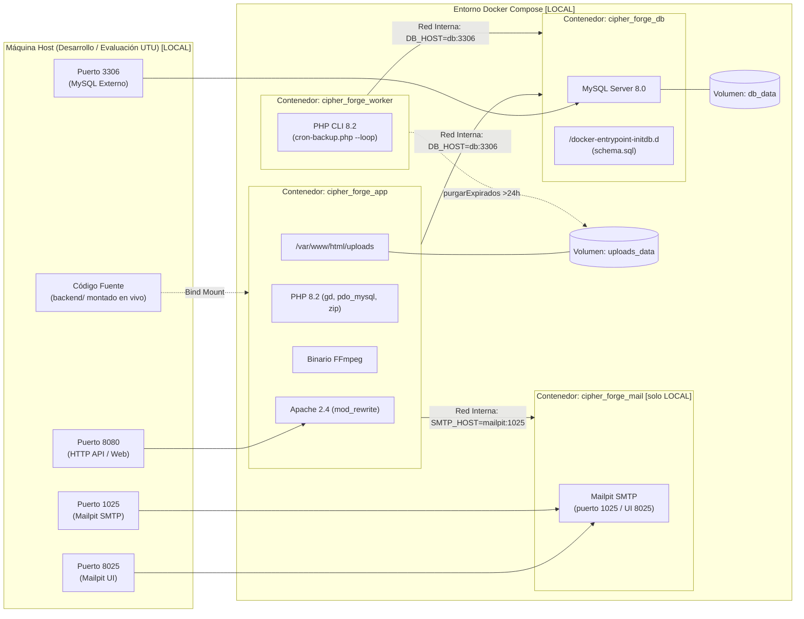

# Documentación de Infraestructura y Contenedores

> **Convenciones:** `COMPARTIDO` = lógica válida en ambos entornos. `LOCAL` = desarrollo/testing/evaluación UTU. `PRODUCCIÓN` = entorno real, no implementado. Todo lo no decidido figura como `PENDIENTE DE DEFINICIÓN`.
>
> **Rol del documento:** referencia técnica de arquitectura e infraestructura. Los pasos de reconstrucción viven en `guia_reconstruccion.md`. No duplicar pasos aquí.
>
> **Arquitectura implementada vs propuesta:** [Secciones 1-4](#1-visión-general-de-la-infraestructura-compartido-en-lógica-local-en-valores) describen hechos comprobados en `backend/`. [Sección 5](#5-arquitectura-y-requisitos-de-producción-producción--brechas-no-hechos) describe brechas y trabajo necesario, no una arquitectura aprobada. Ver [Sección 6](#6-riesgos-restricciones-y-decisiones-pendientes) para decisiones pendientes.

Este documento detalla la arquitectura de infraestructura basada en contenedores Docker para **Cipher_Forge**: servidor web, PHP, MySQL y persistencia. Salvo indicación `PRODUCCIÓN`, describe el stack local.

---

## 1. Visión General de la Infraestructura [COMPARTIDO en lógica, LOCAL en valores]

La infraestructura local se define en `backend/` con `Dockerfile` y `docker-compose.yml` (ver [Sección 2](#2-especificación-del-dockerfile-backenddockerfile-compartido-con-notas-producción) y [Sección 3](#3-especificación-de-docker-compose-backenddocker-composeyml-local-con-tabla-a-producción)). Lógica compartida con producción: API PHP + MySQL 8.0 + almacenamiento en `uploads/` + worker de respaldo/purga. Valores, red y secretos descritos son locales.

> **Nota:** en producción no hay bind mount, ni Mailpit, ni puertos DB/SMTP publicados, ni HTTP sin TLS. Ver [Sección 5](#5-arquitectura-y-requisitos-de-producción-producción--brechas-no-hechos).

---

## 2. Especificación del Dockerfile (`backend/Dockerfile`) [COMPARTIDO con notas PRODUCCIÓN]

<!-- WHAT: Imagen PHP 8.2 + Apache. WHY: Empaqueta FFmpeg/GD/pdo_mysql sin contaminar el host. HOW: Base oficial php:8.2-apache sobre Debian. -->

> **Nota de trazabilidad:** FFmpeg, Docker y filesystem implementan la épica EP4 de [01-requerimientos.md, Épicas](01-requerimientos.md#13-definición-de-épicas) (redactada en general por CC-08). Ver [02-modelado.md, Capas](02-modelado.md#12-descripción-detallada-de-capas).

### 2.1 Código y desglose

La imagen parte de `php:8.2-apache` (Debian), instala FFmpeg, `default-mysql-client`, GD con FreeType/JPEG, `pdo_mysql` y `zip`, y habilita `mod_rewrite`. Copia `php.ini` como `99-cipher-forge.ini` y el entrypoint; el comando por defecto es Apache.

> **Código de la aplicación:** el `Dockerfile` no copia `src/`, `public/`, `routes.php` ni el resto del backend. En local el código llega por el bind mount `.:/var/www/html` de `app` y `worker`. Una imagen inmutable para producción debe incorporar el código en el build (`COPY`/multi-stage) antes de eliminar ese bind mount.

El entrypoint crea `uploads/originals`, `uploads/previews` y `uploads/standard` con `www-data:www-data 775`, espera a MySQL y aplica `database/migration.sql` de forma idempotente en cada arranque; luego ejecuta `exec "$@"`.

> **Notas PRODUCCIÓN:**
> * Sin `USER`: el contenedor corre como root (hallazgo SAST vigente). `PENDIENTE DE DEFINICIÓN`: usuario no privilegiado.
> * `AllowOverride` debe permitir `.htaccess` de `uploads/` y `backups/` (`Require all denied`), o migrar la denegación a config del servidor.
> * En producción la imagen debe ser inmutable (sin bind mount) y versionada para rollback. `PENDIENTE DE DEFINICIÓN`.

### 2.2 Límites del runtime (CF-NUEVO) [COMPARTIDO]

`backend/php.ini` como `99-cipher-forge.ini`:

| Directiva | Valor local | Justificación |
|---|---|---|
| `file_uploads` | On | Subidas habilitadas |
| `upload_max_filesize` | 900M | Video 800 MB + margen (`MultimediaValidator::MAX_VIDEO`) |
| `post_max_size` | 1G | Multipart con varias fotos |
| `memory_limit` | 512M | GD + FFmpeg |
| `max_execution_time` / `max_input_time` | 600 | Videos 800 MB |

> Nivel transporte, mientras CF-03 valida por tipo en aplicación (`MultimediaValidator`). Ver `02-modelado.md` y CC-16. En producción estos valores implican riesgo DoS sin throttling/cuotas (ver [Sección 5.5](#55-validación-errores-y-exposición), [Sección 5.11](#511-rendimiento-disponibilidad-privacidad-y-mantenimiento)).

---

## 3. Especificación de Docker Compose (`backend/docker-compose.yml`) [LOCAL, con tabla a PRODUCCIÓN]

Cuatro servicios en red puente: `app`, `mailpit` (solo desarrollo), `worker`, `db`. `app` y `worker` comparten imagen `cipher-forge:dev`. Fuente: `backend/docker-compose.yml`.

### 3.1 Servicios definidos [LOCAL]

#### A. `app` (`cipher_forge_app`)

* **Build/imagen:** `./Dockerfile` → `cipher-forge:dev`.
* **Puertos:** `8080:80` (HTTP, sin TLS).
* **Volúmenes:** `.:/var/www/html` (bind mount solo-local) + `uploads_data:/var/www/html/uploads`.
* **Env:** `DB_HOST=db`, `DB_NAME=cipher_forge`, `DB_USER=cipher_user`, `DB_PASS=(ver compose, desarrollo)`, `DB_PORT=3306`; `FRONTEND_URL=http://localhost:5501/Gestion-fotografias` (valor efectivo; versiones con `127.0.0.1:5500` desactualizadas); `SMTP_HOST=mailpit`, `SMTP_PORT=1025`, `MAIL_FROM`, `MAIL_FROM_NAME`; `COOKIE_NAME=cipher_forge_token`, `COOKIE_SECURE=false` (HTTP), `COOKIE_SAMESITE=Strict`; `SISTEMA_ALLOWED_IPS` solo como comentario opcional (`docker-compose.yml`). Credenciales de desarrollo, no usar en producción.
* **Depende:** `db`, `mailpit`. **Sin `restart:`** (a diferencia de `worker: unless-stopped`, `mailpit/db: always`).

#### B. `mailpit` (`cipher_forge_mail`) [solo LOCAL]

`axllent/mailpit:latest` (CF-02 / RF18). Puertos `8025:8025` (UI) y `1025:1025` (SMTP). Nada sale de la máquina. **No desplegar en producción.**

#### C. `worker` (`cipher_forge_worker`)

Misma imagen. `command: php cron-backup.php --loop` (CF-12): respaldo diario (HU13/RNF5-RNF7) + purga colaborativa >24h (HU12/RF15). Sin puertos. Volúmenes código + `uploads_data`. Env `DB_*` + `BACKUP_INTERVAL_SEG=86400`, `PURGE_INTERVAL_SEG=3600`. `restart: unless-stopped`. `depends_on: [db]`.

#### D. `db` (`cipher_forge_db`)

`mysql:8.0`. Puerto `3306:3306` publicado (conveniencia local). Env `MYSQL_ROOT_PASSWORD=(ver compose, desarrollo)`, `MYSQL_DATABASE=cipher_forge`, `MYSQL_USER/MYSQL_PASSWORD=(ver compose, desarrollo)`. Volúmenes `db_data:/var/lib/mysql` + `./database/schema.sql:/docker-entrypoint-initdb.d/schema.sql` (solo primera vez del volumen).

### 3.2 Tabla local → producción

| Aspecto | LOCAL (hecho) | PRODUCCIÓN (requerido, `PENDIENTE DE DEFINICIÓN` donde aplique) |
|---|---|---|
| Red | HTTP `:8080`, MySQL `:3306`, Mailpit `:8025/:1025` publicados | HTTPS con terminación TLS; MySQL sin puerto público; sin Mailpit |
| Código | Bind mount en `app`/`worker` | Imagen inmutable, sin bind mount |
| Frontend | Live Server `:5501`, `API_URL=http://localhost:8080` en `frontend-cliente/services/config.js` y `frontend-fotografo/services/config.js` | Origen HTTPS fijo; `API_URL`/`FRONTEND_URL` como parámetros de despliegue |
| Cookies | `COOKIE_SECURE=false`, `SameSite=Strict` mismo-site local | `COOKIE_SECURE=true`; topología mismo-site vs cross-site `PENDIENTE DE DEFINICIÓN` (Strict exige mismo site) |
| Secretos | En compose, de desarrollo | `JWT_SECRET`, `DB_*`, `SMTP_*` fuera de repo/imagen |
| Supervisión | `app` sin `restart`, sin healthcheck | `restart` + healthcheck (`/api/ping` hoy no chequea BD) |

---

## 4. Scripts y mecanismos de persistencia [COMPARTIDO en lógica]

### 4.1 Esquema (`backend/database/schema.sql`) [COMPARTIDO]

11 tablas (`backend/database/schema.sql`): `usuarios` (padre), `clientes` y `fotografos` (FK 1:1 a `usuarios.id`), `colecciones` (`fotografo_id` → `usuarios.id`), `multimedia` (`coleccion_id` → `colecciones.id`), `favoritos` (`usuario_id` → `usuarios.id`; `favorito_id` → `colecciones.id`, CC-15), `acceso_colecciones`, `qr_tokens` (token colaborativo con expiración a 24 h o de acceso), `hashtags`, `coleccion_hashtags` y `backups`. Todas las FK usan `ON DELETE CASCADE`; `usuarios.email` es `UNIQUE`.

> **Nota (fragilidad de nombres, no bloqueante):** la redefinición de la FK de `favoritos` en `backend/database/migration.sql` depende del nombre exacto del constraint `favoritos_ibfk_2` (MySQL lo autogenera y ese nombre puede variar entre versiones/instalaciones); si difiriera, la migración fallaría o no aplicaría el cambio. Correcta en el stack local actual; verificar antes de producción.

### 4.2 Respaldo diario y rotación (RNF5,RNF6,RNF7) [COMPARTIDO en lógica, LOCAL en almacenamiento]

Solución autocontenida PHP sin `mysqldump` ni cron del host: `App\services\BackupService` + `backend/cron-backup.php` (CF-12):

* **Worker (recomendado local):** `php cron-backup.php --loop` (respaldo diario + purga horaria).
* **One-shot:** `php cron-backup.php` (manual/cron host).
* **API:** `POST /sistema/backup`, `GET /sistema/backups` (restringidos por `SistemaController::restringirALocal`, H02).

Volcados en `backend/backups/backup_cipher_forge_{YYYY-MM-DD_HH-mm-ss}.sql`.

**Componentes:**

1. **`backend/backups/`:** resuelto por `App\Core\Config::backupsDir()`. Protegido por `backend/backups/.htaccess` (`Require all denied`, H01). Tres volcados versionados en git pese a `backend/.gitignore` — no versionar respaldos.
2. **`BackupService`:** volcado PDO (`SHOW FULL TABLES`, `SHOW CREATE TABLE`, `$pdo->quote()`), excluye `backups`, rotación FIFO a 3 copias, auditoría en tabla `backups` (`NOW()`).
3. **`cron-backup.php`:** intervalos por entorno (`BACKUP_INTERVAL_SEG`, `PURGE_INTERVAL_SEG`), `MultimediaService::purgarExpirados` + `generarBackup`.
4. **API (`backend/routes.php`):** `POST /sistema/backup`, `GET /sistema/backups`, `POST /sistema/limpiar-colaborativos`.

> **Límites para producción (ver [Sección 5.8](#58-copias-de-seguridad-y-recuperación)):** sin transacción consistente (riesgo con escritura concurrente), solo disco local, sin off-site, sin restore documentado/probado. `rotarBackups` borra físico aun si `unlink` falla.

---

## 5. Arquitectura y requisitos de producción [PRODUCCIÓN — brechas, no hechos]

> Nada de esta sección está implementado ni aprobado como decisión de despliegue. Cada ítem indica estado actual, trabajo necesario y clasificación BLOQUEANTE / NECESARIA / RECOMENDADA / PENDIENTE DE DECISIÓN.

### 5.1 Configuración por entorno y secretos

* **Actual:** `environment:` con valores de desarrollo; `backend/.env` inerte (sin dotenv, solo `getenv()` en `Database`, `Config`, `Mailer` y `CookieAuth`); `.env.example` incompleto (omite `SMTP_*`); `JWT_SECRET` ausente → autogenerado en `uploads/.jwt_secret` (`Config::jwtSecret()`, `0600`).
* **Requerido:** secretos fuera de repo/imagen; `JWT_SECRET` obligatorio (multi-réplica imposible sin secreto compartido); plantilla completa. **BLOQUEANTE.** Valores reales `PENDIENTE DE DEFINICIÓN`.

### 5.2 Servidor, HTTPS, CORS y red

* **Actual (desarrollo local):** Apache HTTP `:80`; `backend/public/index.php` emite `Access-Control-Allow-Origin: *` a orígenes no locales; expone `Content-Disposition, Content-Length`; `COOKIE_SECURE=false` y `SameSite=Strict` (solo funciona cuando frontend y backend comparten mismo sitio/puertos). **Nota:** Esta configuración es válida para evaluación UTU con HTTP sin TLS.
* **Requerido (producción):** TLS + HSTS + `COOKIE_SECURE=true`; CORS con lista cerrada (un solo `FRONTEND_URL` insuficiente para múltiples orígenes); sin puertos DB/SMTP públicos; cabeceras de seguridad. **BLOQUEANTE** (CORS `*`, sin TLS). Elección TLS/proxy `PENDIENTE DE DEFINICIÓN`.

### 5.3 Persistencia y almacenamiento de fotografías

* **Actual:** fotos y base de datos viven en dos volúmenes Docker locales (`uploads_data` con `originals/`, `previews/`, `standard/`; y `db_data` con MySQL). `docker compose down -v` borra ambos volúmenes. Los volcados SQL de `backend/backups/` están en el host y sobreviven a ese comando, pero no hay copia **off-site** ni respaldo de los binarios de `uploads`: si se pierde el host, se pierden originales y respaldos. Nombres de archivo aleatorios (`bin2hex(random_bytes(16))`, `MediaProcessor`): no se adivinan por URL. El acceso directo HTTP está denegado por `.htaccess` (`Require all denied`), condición que depende de que Apache tenga `AllowOverride` habilitado: si el servidor de producción lo desactiva, la denegación deja de aplicar y los binarios originales quedarían servidos públicamente.
* **Requerido:** (1) persistencia gestionada: copias automáticas del proveedor de volúmenes o sustituirlos por almacenamiento externo; (2) snapshots periódicos del estado; (3) decidir migración a Object Storage/CDN según volumen/retención (decisión P5, `PENDIENTE DE DEFINICIÓN`); (4) verificar `AllowOverride` en producción o trasladar la denegación a la config del servidor. **NECESARIA.**

### 5.4 Autenticación, autorización y permisos

* **Actual:** JWT HS256 24h (`backend/src/helpers/Jwt.php`, `backend/src/Core/Config.php`), cookie HttpOnly + Bearer + fallback `?token=` (`backend/src/middlewares/AuthMiddleware.php`); regla central `verificarAccesoALaColeccion` (`backend/src/services/MultimediaService.php`); logout stateless; **rate limiting en endpoints de auth desde 2026-10-21** (`backend/src/middlewares/RateLimitMiddleware.php`: `/auth/login` 5/60 s por IP+email y 20/5 min por IP, `/auth/register` 10/h por IP, `/auth/verificar-email` 6/10 min por IP+email, `/auth/reenviar-codigo` 3/15 min por IP+email y 10/h por IP, `429` + `Retry-After`; ver [implementaciones-futuras.md, Sección 4](implementaciones-futuras.md#4-rate-limiting-global-para-todas-las-rutas) para el alcance global pendiente — subidas y escritura siguen sin tasa, ver [Sección 5.6](#56-dependencias-y-ejecución)); `GET /fotografos` y `GET /fotografos/{id}` públicos con email/teléfono (`backend/src/repository/UserRepository.php`).
* **Requerido:** eliminar/limitar `?token=`; lockout de cuenta progresivo como complemento al rate limit por IP; revisar exposición de datos personales (Ley 18.331, `PENDIENTE DE DEFINICIÓN`); anti-CSRF adicional a `SameSite`. **BLOQUEANTE** (`?token=`) + **NECESARIA** (privacidad, anti-CSRF).

### 5.5 Validación, errores y exposición

* **Actual (validación):** sí se valida MIME real y límites de archivo (30 MB / 800 MB), longitudes de título (≤60), descripción (≤90), hashtag (≤40) y teléfono (≤30). Queda la **carrera de duplicado**: dos registros simultáneos con el mismo email chocan con la restricción `UNIQUE` → 500 en lugar de un 409 "email ya registrado".
* **Actual (fuga):** cuando un error escapa al `try/catch`, el manejador responde 500 interpolando `$e->getMessage()` en el JSON (`backend/public/index.php`). Ese mensaje viaja **hasta el cliente de la red**: ahí está la **"fuga" = filtración de información interna del servidor** (fragmentos de SQL, rutas de archivos, nombres de tablas, mensajes de librerías) que un atacante usa para cartografiar el sistema. `display_errors=0` + `register_shutdown_function` en JSON ya evitan fugar HTML/stack traces, pero el `getMessage()` sigue exponiendo detalle interno.
* **Requerido:** (1) carrera de duplicado → 409; (2) 500 con mensaje genérico, sin `$e->getMessage()` (el detalle queda solo en el log del servidor). **BLOQUEANTE** (fuga de información interna en el 500).

### 5.6 Dependencias y ejecución

* **Actual:** sin Composer/npm; `php:8.2-apache`, `mysql:8.0`, `axllent/mailpit:latest` sin pin de versión; GD/FFmpeg síncronos en request (`max_execution_time=600`); subida invitada anónima de hasta 800 MB por video (límite de aplicación) y 1 GB por petición (límite PHP `post_max_size`), sin rate limiting (`backend/routes.php`, `backend/php.ini`).
* **Requerido:** pin de versiones, throttling/cuotas, procesado asíncrono o límites operativos. **BLOQUEANTE** (subida anónima sin tasa).

### 5.7 Migraciones y consistencia

* **Actual:** `backend/database/schema.sql` + `backend/database/migration.sql` idempotente con `information_schema`, aplicado en cada arranque por `backend/docker-entrypoint.sh` **sin lock ni job único**: si hubiera varias instancias arrancando a la vez, todas aplicarían la misma migración en paralelo. En el stack actual de réplica única no produce incidencias.
* **Requerido:** migración versionada (esquema bajo control de versiones) con lock o job único que garantice que **solo una instancia** aplique cada migración por arranque, esperando el resto. `PENDIENTE DE DEFINICIÓN` (exigible solo antes de escalar a réplicas). **NECESARIA.**

### 5.8 Copias de seguridad y recuperación

* **Actual:** hasta 3 copias `backup_cipher_forge_*.sql` en `backend/backups/` (rotación FIFO), auditoría en la tabla `backups`. La purga colaborativa se ejecuta cada 1 h y elimina archivos no aprobados con más de 24 h; no es una purga de respaldos cada 24 h. Tres carencias:
  * **Sin off-site:** las copias están en el *mismo* disco/máquina que la base de datos original; un incendio o borrado del host destruye original y respaldos a la vez.
  * **Sin consistencia transaccional:** el volcado lee tabla por tabla mientras la aplicación sigue escribiendo; si cae entre la lectura de `colecciones` y la de `multimedia`, la copia queda "a medias" (datos inconexos entre tablas relacionadas) y una restauración produciría referencias rotas.
  * **Sin restore probado:** nadie verificó que esos `.sql` se restauran ni cuánto tardan; una copia nunca restaurada se asume correcta sin evidencia.
* **Requerido:** (1) copias fuera del servidor (**off-site**); (2) definir **RPO** (pérdida máxima de datos tolerable — la copia actual es diaria ⇒ hasta 24 h de pérdida) y **RTO** (tiempo en volver el servicio); (3) **restore probado** sobre entorno limpio, documentado en un **runbook** (procedimiento paso a paso de recuperación). Decisión P6, `PENDIENTE DE DEFINICIÓN`. **BLOQUEANTE.**

### 5.9 Logs, monitorización y diagnóstico

* **Actual:** la única forma de mirar qué pasa es `docker compose logs` (texto libre) y `GET /api/ping`, que responde 200 solo si Apache/PHP están vivos **sin consultar la base de datos**: con MySQL caído, el ping sigue "verde" mientras todos los endpoints con BD fallan. No hay métricas ni alertas: un fallo pasa desapercibido hasta que un usuario lo reporta. Dos conceptos distintos:
  * **Salud (*health*):** saber *en este momento* si el servicio y sus dependencias (BD, disco) responden. Por eso lo pedido es un healthcheck que pruebe la BD real, más `restart` en `backend/docker-compose.yml` para que Docker reinicie `app` automáticamente si se queda colgada.
  * **Observabilidad:** entender *lo que ha pasado* y ver tendencias: logs en formato estructurado (JSON, parseables por herramientas), métricas (peticiones/s, latencias, errores 4xx/5xx, disco) y alertas que notifiquen a una persona ante umbrales.
* **Requerido:** healthcheck con verificación de BD (y `restart`/`healthcheck` de `app`), logs estructurados, monitorización con alertas; herramienta a elegir `PENDIENTE DE DEFINICIÓN`. **NECESARIA** (salud) + **RECOMENDADA** (observabilidad).

### 5.10 Despliegue, post-despliegue y reversión

* **Actual:** `compose up --build -d`, `stop/start`, `down -v` (destructivo). La imagen local se construye con tag `cipher-forge:dev` y el código llega por bind mount; el `Dockerfile` no copia la aplicación.
* **Requerido:** imagen inmutable versionada (tag de versión, código incluido en el build, sin bind mount), migración controlada, comprobaciones ([guia_reconstruccion.md, Sección 2.4](guia_reconstruccion.md#24-comprobaciones-posteriores-producción)), rollback de aplicación por tag y de datos por snapshot/restore. `docker logs` sigue disponible; la inmutabilidad no impide `docker exec`/`docker cp` para diagnóstico ni convierte el contenedor en solo lectura, y no sustituye los respaldos off-site (ver [Sección 5.3](#53-persistencia-y-almacenamiento-de-fotografías) y [Sección 5.8](#58-copias-de-seguridad-y-recuperación)). Procedimiento ejecutable `PENDIENTE DE DEFINICIÓN`. **NECESARIA.**

### 5.11 Rendimiento, disponibilidad, privacidad y mantenimiento

Sin paginación en listados; FFmpeg/GD síncronos; `memory_limit=512M`; divergencia horaria PHP/MySQL (`time()` vs `NOW()`); `app` sin `restart`. Privacidad: directorio público con datos de contacto. **NECESARIA** (paginación, TZ, restart) + **RECOMENDADA** (rendimiento, headers).

### 5.12 Pruebas antes de producción

Existente (equipo, no re-ejecutado aquí): `backend/FAILS-TESTED.md` (62 E2E), `backend/Done.md` (correcciones 2026-09-07), `06-testing.md` (varias `Pendiente de confirmar en navegador`). Exigible: E2E, restauración, carga, revisión SAST con Quality Gate en verde. Criterios `PENDIENTE DE DEFINICIÓN`.

---

## 6. Riesgos, restricciones y decisiones pendientes

**Clasificación:** BLOQUEANTE impide despliegue; NECESARIA debe resolverse por requisito; RECOMENDADA mejora seguridad/operación; PENDIENTE DE DECISIÓN requiere PM/cliente.

| ID | Riesgo / brecha | Evidencia | Clase |
|---|---|---|---|
| B1 | Sin TLS, `COOKIE_SECURE=false` | `backend/docker-compose.yml` | BLOQUEANTE |
| B3 | Subida anónima sin tasa (800 MB por video / 1G por petición) | `backend/routes.php`, `backend/php.ini` | BLOQUEANTE |
| B4 | Secretos dev + `JWT_SECRET` ausente + dumps en git | `backend/docker-compose.yml`, `Config::jwtSecret()`, `git ls-files backups/` | BLOQUEANTE |
| B5 | CORS `*` + fuga 500 + JWT en URL | `backend/public/index.php`, `AuthMiddleware` | BLOQUEANTE |
| B6 | SMTP plano, Mailpit no-prod | `backend/src/helpers/Mailer.php` | BLOQUEANTE |
| B7 | Sin restore/off-site/consistencia | `BackupService::generarSqlDump()` | BLOQUEANTE |
| N1 | Sin `restart` en `app`, sin healthcheck (`/api/ping` no chequea BD) | `backend/docker-compose.yml`, `HomeController` | NECESARIA |
| N2 | Frontend sin hosting; `API_URL` hardcodeada | `frontend-cliente/services/config.js`, `frontend-fotografo/services/config.js` | NECESARIA |
| N3 | Carrera de duplicado 409/500, sin paginación, TZ no fijada | `AuthService::register()`, `backend/database/schema.sql` | NECESARIA |
| N4 | Directorio público expone email/teléfono | `UserRepository` | NECESARIA |
| R1 | Root, headers, logs, throttling, sesión 24h tras logout | `backend/Dockerfile`, `backend/public/index.php`, `Jwt`/`Config` | RECOMENDADA |

**Decisiones P1-P10 `PENDIENTE DE DEFINICIÓN`:** P1 alcance (¿sustituye exclusión UTU? [01-requerimientos.md, Sección 10, ítem 5](01-requerimientos.md#10-alcance-excluido-para-esta-primera-versión)), P2 proveedor/entorno (sin imponer), P3 dominios/mismo-site, P4 SMTP real, P5 volumen/retención, P6 off-site/RPO-RTO, P7 privacidad directorio, P8 secretos/TLS obligatorios, P9 operador, P10 modelo `/sistema/*` y aceptación/testing. Sin estas no hay diseño final.

**Restricciones:** no exponer secretos en docs; no imponer proveedor/cloud/BD/herramienta; distinguir hecho/deducción/propuesta/pendiente; no declarar pruebas no ejecutadas.

---

## Trazabilidad

* Requisitos: `01-requerimientos.md` (RF7/RF26 30 MB/800 MB, RF15/HU12 purga, HU13/RNF5-RNF7, EP4/EP7, [Sección 10](01-requerimientos.md#10-alcance-excluido-para-esta-primera-versión) excluido prod, RNF4 futuro prod).
* Modelo: [02-modelado.md, Sección 1](02-modelado.md#1-arquitectura-propuesta-del-sistema) y [Sección 2](02-modelado.md#2-modelado-de-datos-diagrama-entidad-relación) (capas, ERD 11 tablas, flujos subida/descarga).
* Seguridad: [03-seguridad.md](03-seguridad.md) (amenazas, Términos, PSI; [Sección 4.1](03-seguridad.md#41-protección-de-endpoints-de-administración-sistema-cf-08--cc-14) sigue como cambio a futuro), Ley 18.331.
* Cambios: CC-11/CCT-11 (worker), CC-14 (postergado `/sistema/*`, R-03), CC-16/CCT-16 (php.ini), CC-27 (30 MB).
* Backend: `backend/routes.php`, `backend/src/Core/Config.php`, `backend/src/Core/Database.php`, `backend/src/middlewares/AuthMiddleware.php`, `backend/src/helpers/Jwt.php`, `backend/src/helpers/CookieAuth.php`, `backend/src/helpers/Mailer.php`, `backend/src/helpers/MediaProcessor.php`, `backend/src/services/BackupService.php`, `backend/cron-backup.php`, `backend/SISTEMA_LOCAL.md`, `backend/EMAIL_CONFIG.md`, `backend/important.md` H01/H02/H09 resueltos.
* Reconstrucción: [guia_reconstruccion.md, Parte 1](guia_reconstruccion.md#parte-1--reconstrucción-y-ejecución-local-local) y [Parte 2](guia_reconstruccion.md#parte-2--preparación-y-reconstrucción-en-producción-producción).

> Estado documental: refleja el código inspeccionado por lectura directa; sin ejecución del stack Docker ni pruebas propias.
