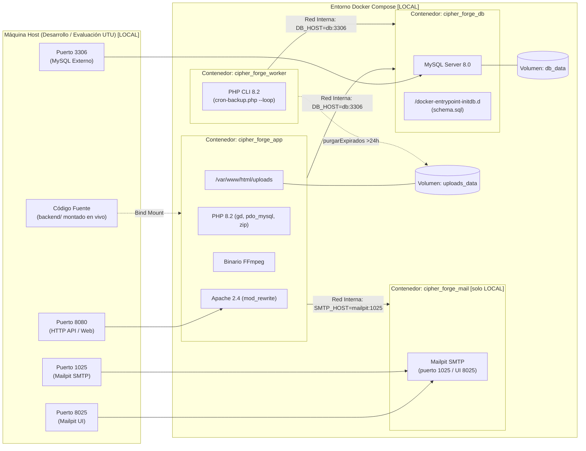

# Documentación de Infraestructura y Contenedores

> **Convenciones:** `COMPARTIDO` = lógica válida en ambos entornos. `LOCAL` = desarrollo/testing/evaluación UTU. `PRODUCCIÓN` = entorno real, no implementado. Todo lo no decidido figura como `PENDIENTE DE DEFINICIÓN`.
>
> **Rol del documento:** referencia técnica de arquitectura e infraestructura. Los pasos de reconstrucción viven en `guia_reconstruccion.md`. No duplicar pasos aquí.
>
> **Arquitectura implementada vs propuesta:** §§1-4 describen hechos comprobados en `backend/`. §5 describe brechas y trabajo necesario, no una arquitectura aprobada. Ver §6 para decisiones pendientes.

Este documento detalla la arquitectura de infraestructura basada en contenedores Docker para **Cipher_Forge**: servidor web, PHP, MySQL y persistencia. Salvo indicación `PRODUCCIÓN`, describe el stack local.

---

## 1. Visión General de la Infraestructura [COMPARTIDO en lógica, LOCAL en valores]

La infraestructura local se define en `backend/` con `Dockerfile` y `docker-compose.yml` (ver §2-§3). Lógica compartida con producción: API PHP + MySQL 8.0 + almacenamiento en `uploads/` + worker de respaldo/purga. Valores, red y secretos descritos son locales.



> **Nota:** en producción no hay bind mount, ni Mailpit, ni puertos DB/SMTP publicados, ni HTTP sin TLS. Ver §5.

---

## 2. Especificación del Dockerfile (`backend/Dockerfile`) [COMPARTIDO con notas PRODUCCIÓN]

<!-- WHAT: Imagen PHP 8.2 + Apache. WHY: Empaqueta FFmpeg/GD/pdo_mysql sin contaminar el host. HOW: Base oficial php:8.2-apache sobre Debian. -->

> **Nota de trazabilidad:** FFmpeg, Docker y filesystem implementan la épica EP4 de 01-requerimientos.md (redactada en general por CC-08). Ver `01-requerimientos.md EP4` y `02-modelado.md Capa de Almacenamiento`.

### 2.1 Código y desglose

Extracto fiel — fuente: `backend/Dockerfile:3-36` (se omiten comentarios de cabecera sin valor normativo):

```dockerfile
# 1. Base oficial PHP 8.2 + Apache sobre Debian
FROM php:8.2-apache

# 2. ffmpeg, default-mysql-client (diagnóstico), libpng-dev, libjpeg-dev,
#    libfreetype6-dev, libzip-dev, zip, unzip
RUN apt-get update && apt-get install -y \
    ffmpeg \
    default-mysql-client \
    libpng-dev \
    libjpeg-dev \
    libfreetype6-dev \
    libzip-dev \
    zip \
    unzip \
    && apt-get clean \
    && rm -rf /var/lib/apt/lists/*

# 3. GD con FreeType/JPEG + pdo_mysql + zip
RUN docker-php-ext-configure gd --with-freetype --with-jpeg \
    && docker-php-ext-install -j$(nproc) gd pdo_mysql zip

# 4. mod_rewrite para Front Controller (index.php)
RUN a2enmod rewrite

# 5. Workdir
WORKDIR /var/www/html

# 6. Límites PHP alineados a negocio (imagen 30 MB / video 800 MB).
#    Sobrescribe upload_max_filesize=2M / post_max_size=8M por defecto.
COPY php.ini /usr/local/etc/php/conf.d/99-cipher-forge.ini

# 7-8. Entrypoint + CMD (CF-12). Entrypoint respeta "$@":
#    app → apache2-foreground; worker → php cron-backup.php --loop
COPY docker-entrypoint.sh /usr/local/bin/docker-entrypoint.sh
RUN chmod +x /usr/local/bin/docker-entrypoint.sh
CMD ["apache2-foreground"]
ENTRYPOINT ["/usr/local/bin/docker-entrypoint.sh"]
```

Fuente: `backend/Dockerfile:3-36`.

Entrypoint (`backend/docker-entrypoint.sh:1-44`):

1. Crea `uploads/originals,previews,standard` con `www-data:www-data 775`.
2. Espera MySQL con `mysql --skip-ssl` (30 reintentos) y aplica `database/migration.sql` idempotente en cada arranque.
3. `exec "$@"`.

> **Notas PRODUCCIÓN:**
> * Sin `USER`: el contenedor corre como root (hallazgo SAST vigente). `PENDIENTE DE DEFINICIÓN`: usuario no privilegiado.
> * `AllowOverride` debe permitir `.htaccess` de `uploads/` y `backups/` (`Require all denied`), o migrar la denegación a config del servidor.
> * En producción la imagen debe ser inmutable (sin bind mount) y versionada para rollback. `PENDIENTE DE DEFINICIÓN`.

### 2.2 Límites del runtime (CF-NUEVO) [COMPARTIDO]

`backend/php.ini` como `99-cipher-forge.ini` (`backend/php.ini:7-20`):

| Directiva | Valor local | Justificación |
|---|---|---|
| `file_uploads` | On | Subidas habilitadas |
| `upload_max_filesize` | 900M | Video 800 MB + margen (`MultimediaValidator.php:17`) |
| `post_max_size` | 1G | Multipart con varias fotos |
| `memory_limit` | 512M | GD + FFmpeg |
| `max_execution_time` / `max_input_time` | 600 | Videos 800 MB |

> Nivel transporte, mientras CF-03 valida por tipo en aplicación (`MultimediaValidator.php:43-63`). Ver `02-modelado.md` y CC-16. En producción estos valores implican riesgo DoS sin throttling/cuotas (ver §5.5, §5.11).

---

## 3. Especificación de Docker Compose (`backend/docker-compose.yml`) [LOCAL, con tabla a PRODUCCIÓN]

Cuatro servicios en red puente: `app`, `mailpit` (solo desarrollo), `worker`, `db`. `app` y `worker` comparten imagen `cipher-forge:dev`. Fuente: `backend/docker-compose.yml:1-97`.

### 3.1 Servicios definidos [LOCAL]

#### A. `app` (`cipher_forge_app`)

* **Build/imagen:** `./Dockerfile` → `cipher-forge:dev`.
* **Puertos:** `8080:80` (HTTP, sin TLS).
* **Volúmenes:** `.:/var/www/html` (bind mount solo-local) + `uploads_data:/var/www/html/uploads`.
* **Env:** `DB_HOST=db`, `DB_NAME=cipher_forge`, `DB_USER=cipher_user`, `DB_PASS=(ver compose, desarrollo)`, `DB_PORT=3306`; `FRONTEND_URL=http://localhost:5501/Gestion-fotografias` (valor efectivo; versiones con `127.0.0.1:5500` desactualizadas); `SMTP_HOST=mailpit`, `SMTP_PORT=1025`, `MAIL_FROM`, `MAIL_FROM_NAME`; `COOKIE_NAME=cipher_forge_token`, `COOKIE_SECURE=false` (HTTP), `COOKIE_SAMESITE=Strict`; `SISTEMA_ALLOWED_IPS` solo como comentario opcional (`docker-compose.yml:40`). Credenciales de desarrollo, no usar en producción.
* **Depende:** `db`, `mailpit`. **Sin `restart:`** (a diferencia de `worker: unless-stopped`, `mailpit/db: always`).

#### B. `mailpit` (`cipher_forge_mail`) [solo LOCAL]

`axllent/mailpit:latest` (CF-02 / RF18). Puertos `8025:8025` (UI) y `1025:1025` (SMTP). Nada sale de la máquina. **No desplegar en producción.**

#### C. `worker` (`cipher_forge_worker`)

Misma imagen. `command: php cron-backup.php --loop` (CF-12): respaldo diario (HU13/RNF5-RNF7) + purga colaborativa >24h (HU12/RF15). Sin puertos. Volúmenes código + `uploads_data`. Env `DB_*` + `BACKUP_INTERVAL_SEG=86400`, `PURGE_INTERVAL_SEG=3600`. `restart: unless-stopped`. `depends_on: [db]`.

#### D. `db` (`cipher_forge_db`)

`mysql:8.0`. Puerto `3306:3306` publicado (conveniencia local). Env `MYSQL_ROOT_PASSWORD=(ver compose, desarrollo)`, `MYSQL_DATABASE=cipher_forge`, `MYSQL_USER/MYSQL_PASSWORD=(ver compose, desarrollo)`. Volúmenes `db_data:/var/lib/mysql` + `./database/schema.sql:/docker-entrypoint-initdb.d/schema.sql` (solo primera vez del volumen).

### 3.2 Tabla local → producción

| Aspecto | LOCAL (hecho) | PRODUCCIÓN (requerido, `PENDIENTE DE DEFINICIÓN` donde aplique) |
|---|---|---|
| Red | HTTP `:8080`, MySQL `:3306`, Mailpit `:8025/:1025` publicados | HTTPS con terminación TLS; MySQL sin puerto público; sin Mailpit |
| Código | Bind mount en `app`/`worker` | Imagen inmutable, sin bind mount |
| Frontend | Live Server `:5501`, `API_URL=http://localhost:8080` en `frontend-*/services/config.js:2` | Origen HTTPS fijo; `API_URL`/`FRONTEND_URL` como parámetros de despliegue |
| Cookies | `COOKIE_SECURE=false`, `SameSite=Strict` mismo-site local | `COOKIE_SECURE=true`; topología mismo-site vs cross-site `PENDIENTE DE DEFINICIÓN` (Strict exige mismo site) |
| Secretos | En compose, de desarrollo | `JWT_SECRET`, `DB_*`, `SMTP_*` fuera de repo/imagen |
| Supervisión | `app` sin `restart`, sin healthcheck | `restart` + healthcheck (`/api/ping` hoy no chequea BD) |

---

## 4. Scripts y mecanismos de persistencia [COMPARTIDO en lógica]

### 4.1 Esquema (`backend/database/schema.sql`) [COMPARTIDO]

11 tablas (`schema.sql:3-87`): `usuarios` (padre), `clientes`, `fotografos` (`politicas_aceptadas`), `colecciones`, `multimedia` (`ruta_original`, `vista_previa`, `poster`, `tamanio`, `es_invitado`, `aprobado`, `tipo`), `favoritos` (a `colecciones.id`, CC-15), `acceso_colecciones`, `qr_tokens` (`colaborativo` 24h / `acceso` permanente), `hashtags`, `coleccion_hashtags`, `backups`. FK con `ON DELETE CASCADE`, `email` UNIQUE.

> **Advertencia BLOQUEANTE:** `backend/database/migration.sql:50` ejecuta `DELETE FROM favoritos;` incondicional y `docker-entrypoint.sh:33-38` lo aplica en **cada arranque**. Cada reinicio vacía `favoritos`. No usar en producción sin corrección. Además la redefinición de FK por nombre `favoritos_ibfk_2` (`migration.sql:52-66`) es frágil entre versiones.

### 4.2 Respaldo diario y rotación (RNF5,RNF6,RNF7) [COMPARTIDO en lógica, LOCAL en almacenamiento]

Solución autocontenida PHP sin `mysqldump` ni cron del host: `App\services\BackupService` + `backend/cron-backup.php` (CF-12):

* **Worker (recomendado local):** `php cron-backup.php --loop` (respaldo diario + purga horaria).
* **One-shot:** `php cron-backup.php` (manual/cron host).
* **API:** `POST /sistema/backup`, `GET /sistema/backups` (restringidos por `SistemaController::restringirALocal`, H02).

Volcados en `backend/backups/backup_cipher_forge_{YYYY-MM-DD_HH-mm-ss}.sql`.

**Componentes:**

1. **`backend/backups/`:** resuelto por `App\Core\Config::backupsDir()`. Protegido por `backend/backups/.htaccess` (`Require all denied`, H01). Tres volcados versionados en git pese a `backend/.gitignore:11` — no versionar respaldos.
2. **`BackupService.php:28-106`:** volcado PDO (`SHOW FULL TABLES`, `SHOW CREATE TABLE`, `$pdo->quote()`), excluye `backups`, rotación FIFO a 3 copias, auditoría en tabla `backups` (`NOW()`).
3. **`cron-backup.php:32-64`:** intervalos por entorno (`BACKUP_INTERVAL_SEG`, `PURGE_INTERVAL_SEG`), `MultimediaService::purgarExpirados` + `generarBackup`.
4. **API (`backend/routes.php:90-93`):** `POST /sistema/backup`, `GET /sistema/backups`, `POST /sistema/limpiar-colaborativos`.

> **Límites para producción (ver §5.8):** sin transacción consistente (riesgo con escritura concurrente), solo disco local, sin off-site, sin restore documentado/probado. `rotarBackups` borra físico aun si `unlink` falla.

---

## 5. Arquitectura y requisitos de producción [PRODUCCIÓN — brechas, no hechos]

> Nada de esta sección está implementado ni aprobado como decisión de despliegue. Cada ítem indica estado actual, trabajo necesario y clasificación BLOQUEANTE / NECESARIA / RECOMENDADA / PENDIENTE DE DECISIÓN.

### 5.1 Configuración por entorno y secretos

* **Actual:** `environment:` con valores de desarrollo; `backend/.env` inerte (sin dotenv, solo `getenv()` en `Database.php:33-38`, `Config.php:19,99`, `Mailer.php:67-80`, `CookieAuth.php:23-58`); `.env.example` incompleto (omite `SMTP_*`); `JWT_SECRET` ausente → autogenerado en `uploads/.jwt_secret` (`Config.php:24-36`, `0600`).
* **Requerido:** secretos fuera de repo/imagen; `JWT_SECRET` obligatorio (multi-réplica imposible sin secreto compartido); plantilla completa. **BLOQUEANTE.** Valores reales `PENDIENTE DE DEFINICIÓN`.

### 5.2 Servidor, HTTPS, CORS y red

* **Actual (desarrollo local):** Apache HTTP `:80`; `public/index.php:75-81` emite `Access-Control-Allow-Origin: *` a orígenes no locales; expone `Content-Disposition, Content-Length`; `COOKIE_SECURE=false` y `SameSite=Strict` (solo funciona cuando frontend y backend comparten mismo sitio/puertos). **Nota:** Esta configuración es válida para evaluación UTU con HTTP sin TLS.
* **Requerido (producción):** TLS + HSTS + `COOKIE_SECURE=true`; CORS con lista cerrada (un solo `FRONTEND_URL` insuficiente para múltiples orígenes); sin puertos DB/SMTP públicos; cabeceras de seguridad. **BLOQUEANTE** (CORS `*`, sin TLS). Elección TLS/proxy `PENDIENTE DE DEFINICIÓN`.

### 5.3 Persistencia y almacenamiento de fotografías

* **Actual:** `uploads_data` (`originals/`, `previews/`, `standard/`) + `db_data`; nombres aleatorios `bin2hex(random_bytes(16))` (`MediaProcessor.php:25-28`); denegación por `.htaccess` dependiente de `AllowOverride`.
* **Requerido:** persistencia gestionada + snapshots; Object Storage/CDN `PENDIENTE DE DEFINICIÓN` según volumen/retención (P5); `AllowOverride` verificado o denegación en config. **NECESARIA.**

### 5.4 Autenticación, autorización y permisos

* **Actual:** JWT HS256 24h (`Jwt.php`, `Config.php:40-43`), cookie HttpOnly + Bearer + fallback `?token=` (`AuthMiddleware.php:103-116,87-90`); regla central `verificarAccesoALaColeccion` (`MultimediaService.php:512-530`); logout stateless; sin throttling en `/auth/login`, `/auth/verificar-email` (6 dígitos), `/auth/reenviar-codigo`; `GET /fotografos`, `/{id}` públicos con email/teléfono (`UserRepository.php:212-242`).
* **Requerido:** eliminar/limitar `?token=`; throttling/lockout; revisar exposición de datos personales (Ley 18.331, `PENDIENTE DE DEFINICIÓN`); anti-CSRF adicional a `SameSite`. **BLOQUEANTE** (`?token=`, sin throttling) + **NECESARIA** (privacidad).

### 5.5 Validación, errores y exposición

* **Actual:** MIME real + 30 MB/800 MB + título ≤60/descripción ≤90/hashtag ≤40; registro sin límites de longitud vs VARCHAR (90/60/30) → 500 en lugar de 400; `index.php:102` filtra `$e->getMessage()` en 500; `display_errors=0`/`log_errors=1` + `register_shutdown_function` 500 JSON (`index.php:7-30`).
* **Requerido:** completar longitudes, convertir carrera de duplicado en 409, mensaje 500 genérico sin detalles. **BLOQUEANTE** (fuga) + **NECESARIA** (validación).

### 5.6 Dependencias y ejecución

* **Actual:** sin Composer/npm; `php:8.2-apache`, `mysql:8.0`, `axllent/mailpit:latest` sin pin de versión; GD/FFmpeg síncronos en request (`max_execution_time=600`); subida invitada anónima hasta 800 MB/1G sin rate limiting (`routes.php:72`, `php.ini:10-13`).
* **Requerido:** pin de versiones, throttling/cuotas, procesado asíncrono o límites operativos. **BLOQUEANTE** (subida anónima sin tasa).

### 5.7 Migraciones y consistencia

* **Actual:** `schema.sql` + `migration.sql` idempotente con `information_schema`, aplicado en cada boot sin lock.
* **Requerido:** eliminar `DELETE FROM favoritos`, migración versionada con lock/job único para réplicas. **BLOQUEANTE.**

### 5.8 Copias de seguridad y recuperación

* **Actual:** 3 copias locales, auditoría en `backups`, purga 24h. Sin restore, sin off-site, sin consistencia transaccional.
* **Requerido:** off-site, RPO/RTO, restore probado y runbook. `PENDIENTE DE DEFINICIÓN`. **BLOQUEANTE.**

### 5.9 Logs, monitorización y diagnóstico

* **Actual:** `docker compose logs`, `/api/ping` sin chequeo DB, sin métricas.
* **Requerido:** healthcheck con DB, logs estructurados, monitorización/alertas. `PENDIENTE DE DEFINICIÓN`. **NECESARIA** (salud) + **RECOMENDADA** (observabilidad).

### 5.10 Despliegue, post-despliegue y reversión

* **Actual:** `compose up --build -d`, `stop/start`, `down -v` (destructivo).
* **Requerido:** imagen inmutable versionada, migración controlada, comprobaciones (§ guia 2.4), rollback (snapshot + imagen). Procedimiento ejecutable `PENDIENTE DE DEFINICIÓN`. **NECESARIA.**

### 5.11 Rendimiento, disponibilidad, privacidad y mantenimiento

Sin paginación en listados; FFmpeg/GD síncronos; `memory_limit=512M`; divergencia horaria PHP/MySQL (`time()` vs `NOW()`); `app` sin `restart`. Privacidad: directorio público con datos de contacto. **NECESARIA** (paginación, TZ, restart) + **RECOMENDADA** (rendimiento, headers).

### 5.12 Pruebas antes de producción

Existente (equipo, no re-ejecutado aquí): `backend/FAILS-TESTED.md` (62 E2E), `backend/Done.md` (correcciones 2026-09-07), `docs/06-testing.md` (varias `Pendiente de confirmar en navegador`). Exigible: E2E, restauración, carga, revisión SAST con Quality Gate en verde. Criterios `PENDIENTE DE DEFINICIÓN`.

---

## 6. Riesgos, restricciones y decisiones pendientes

**Clasificación:** BLOQUEANTE impide despliegue; NECESARIA debe resolverse por requisito; RECOMENDADA mejora seguridad/operación; PENDIENTE DE DECISIÓN requiere PM/cliente.

| ID | Riesgo / brecha | Evidencia | Clase |
|---|---|---|---|
| B1 | Sin TLS, `COOKIE_SECURE=false` | `compose:10,36` | BLOQUEANTE |
| B2 | `DELETE FROM favoritos` en cada boot | `migration.sql:50` + `entrypoint:33-38` | BLOQUEANTE |
| B3 | Subida anónima sin tasa (800 MB/1G) | `routes.php:72`, `php.ini:10-13` | BLOQUEANTE |
| B4 | Secretos dev + `JWT_SECRET` ausente + dumps en git | `compose:14-40`, `Config.php:24-36`, `git ls-files backups/` | BLOQUEANTE |
| B5 | CORS `*` + fuga 500 + JWT en URL | `index.php:80,102`, `AuthMiddleware:87-90` | BLOQUEANTE |
| B6 | SMTP plano, Mailpit no-prod | `Mailer.php:91-146` | BLOQUEANTE |
| B7 | Sin restore/off-site/consistencia | `BackupService.php:111-164` | BLOQUEANTE |
| N1 | Sin `restart` en `app`, sin healthcheck (`/api/ping` no chequea BD) | `docker-compose.yml:3-43`, `HomeController.php:13-20` | NECESARIA |
| N2 | Frontend sin hosting; `API_URL` hardcodeada | `frontend-*/services/config.js:2` | NECESARIA |
| N3 | Validación longitudes registro, carrera duplicado 409/500, sin paginación, TZ no fijada | `AuthValidator.php:20-69`, `schema.sql:3-13`, `AuthService.php:38-48` | NECESARIA |
| N4 | Directorio público expone email/teléfono | `UserRepository.php:212-242` | NECESARIA |
| R1 | Root, headers, logs, throttling, sesión 24h tras logout | `Dockerfile`, `index.php`, `Jwt/Config` | RECOMENDADA |

**Decisiones P1-P10 `PENDIENTE DE DEFINICIÓN`:** P1 alcance (¿sustituye exclusión UTU? `01 §10.5`), P2 proveedor/entorno (sin imponer), P3 dominios/mismo-site, P4 SMTP real, P5 volumen/retención, P6 off-site/RPO-RTO, P7 privacidad directorio, P8 secretos/TLS obligatorios, P9 operador, P10 modelo `/sistema/*` y aceptación/testing. Sin estas no hay diseño final.

**Restricciones:** no exponer secretos en docs; no imponer proveedor/cloud/BD/herramienta; distinguir hecho/deducción/propuesta/pendiente; no declarar pruebas no ejecutadas.

---

## Trazabilidad

* Requisitos: `01-requerimientos.md` (RF7/RF26 30 MB/800 MB, RF15/HU12 purga, HU13/RNF5-RNF7, EP4/EP7, §10 excluido prod, RNF4 futuro prod).
* Modelo: `02-modelado.md §1-§2` (capas, ERD 11 tablas, flujos subida/descarga).
* Seguridad: `03-seguridad.md` (amenazas, Términos, PSI; §4.1 desactualizado), Ley 18.331.
* Cambios: CC-11/CCT-11 (worker), CC-14 (postergado `/sistema/*`, R-03), CC-16/CCT-16 (php.ini), CC-27 (30 MB).
* Backend: `routes.php`, `Config.php`, `Database.php`, `AuthMiddleware.php`, `Jwt.php`, `CookieAuth.php`, `Mailer.php`, `MediaProcessor.php`, `BackupService.php`, `cron-backup.php`, `SISTEMA_LOCAL.md`, `EMAIL_CONFIG.md`, `important.md` H01/H02/H09 resueltos.
* Reconstrucción: `guia_reconstruccion.md Parte 1/Parte 2`.

> Estado documental: refleja el código inspeccionado por lectura directa; sin ejecución del stack Docker ni pruebas propias.
